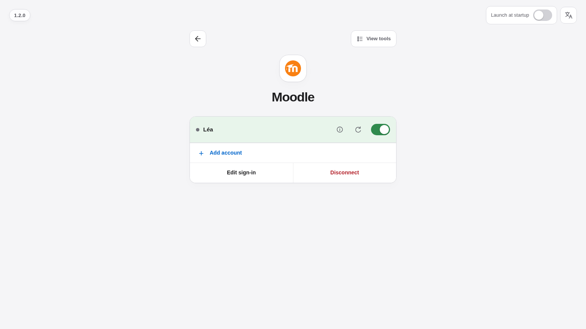
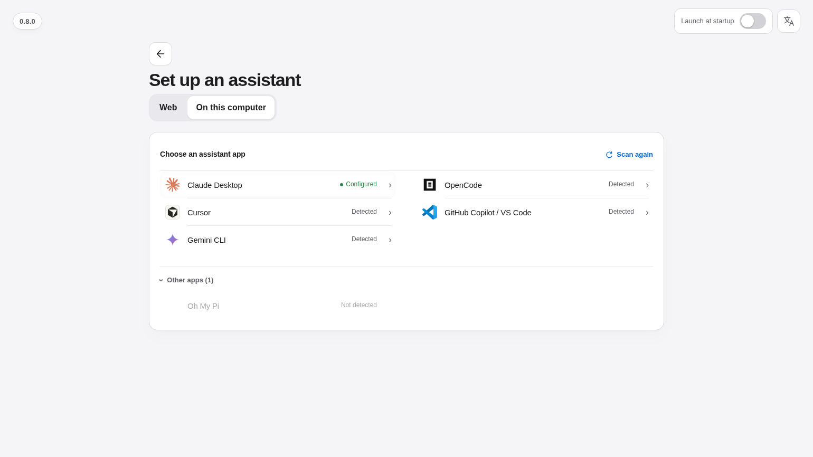

<h1 align="center">student-mcp</h1>
<p align="center">
  
</p>
<p align="center">Ask your AI about your courses, deadlines, grades and files — without typing your school password into the chat.</p>

## Install

### Windows

Download **[student-mcp-setup.exe](https://github.com/CloudDown/student-mcp/releases/latest/download/student-mcp-setup.exe)** and open it. Keep **Open student-mcp** selected.

### macOS

Download **[student-mcp.dmg](https://github.com/CloudDown/student-mcp/releases/latest/download/student-mcp.dmg)**, open it, double-click **Install student-mcp**, then **Install and open**.

**If macOS blocks opening:** the current app is not signed with an Apple Developer ID or notarized by Apple. If you trust this download from our official GitHub release:

1. Try opening **Install student-mcp** once, then dismiss the warning about an unidentified developer or Apple being unable to check the app.
2. Open **System Settings → Privacy & Security**, scroll to **Security**, and choose **Open Anyway** for **Install student-mcp**.
3. Confirm **Open**, then continue with **Install and open**. If the installed **student-mcp** app is also blocked by the same warning, repeat these steps for that app.

This authorizes only the selected app; do not disable Gatekeeper or remove quarantine attributes. If macOS reports malware, damage, or that the app will harm your computer, stop rather than override it. See [Apple's instructions](https://support.apple.com/en-us/102445).

### Linux

```sh
curl -fsSL https://raw.githubusercontent.com/CloudDown/student-mcp/main/tools/packaging/install.sh | bash
```

The installer adds student-mcp to the application menu. Windows or macOS may warn that the app is unsigned until publisher signatures are added; do not turn off those checks.

## 1. Open student-mcp

Launch it from the Start menu, Applications, or your app launcher. A local page opens. Closing the tab leaves a tray icon; quit from there when you are done.

<p align="center"></p>

## 2. Connect your school

Click **Moodle**, **Omnivox**, **Brightspace** or **Canvas** — or type your school in the search field, which opens the right service with the address already filled in. Then **Connect with browser**. Sign in on the school site, including MFA if asked. Only a token or a private browser profile is saved — not your password. Canvas uses that session cookie; it does not ask for a personal access token.

If Chrome, Edge or Brave is already installed, that browser is used. A download is offered only if none is found, and only after you agree.

<p align="center"></p>

When the page says you are connected, go back to the home screen.

Use the pencil on a connected account to give it a name, such as **Léa** or **Alex**. Your assistant can use that label to select the right platform and account when you ask “What are Léa’s deadlines?” Names are labels you choose, not verified identities; if one is ambiguous, the assistant should ask you to clarify.

You can keep several accounts on the same platform — another school, or a child’s account. The switch beside each name is what assistants may use; turning it off hides that account without deleting the login. A green, amber or red dot is the connection status. One MCP link serves every enabled account.

<p align="center"></p>

<p align="center"></p>

## 3. Copy your AI link

Your link appears under your school. Press the copy button. Keep this computer awake and online. Do not share your real link: anyone who has it can access enabled tools. Open the card to choose between **On this computer** and **From the web**.

<p align="center"></p>

## 4. Add the link to your assistant

Paste the **complete** `https://…/mcp/…` link into the assistant’s MCP connector settings, not into a chat message.

Click **Set up an assistant** under **Your link**, then choose **Web** or **On this computer**. **Web** has three-step guides for **Grok**, **Claude**, **ChatGPT** and **Gemini**, with illustrative interface renders and a copy button where you need the public link. **On this computer** shows supported local apps: select a detected app, review the change, then confirm. No terminal or public link is needed. Automatic setup supports Claude Desktop, Claude Code, Codex / ChatGPT Desktop, Gemini CLI, OpenCode, Cursor, Grok Build, Oh My Pi, GitHub Copilot / VS Code, Windsurf, Pi, Qwen Code, Kiro, Amp, Crush and Devin CLI. Other settings and MCP servers are preserved, and an existing configuration is backed up first. A configured app can be reset with **Remove setup**, which deletes only the student-mcp entry. Detection checks known locations, not every app on the disk; **Scan again** refreshes the list.

<p align="center"></p>

### Grok

1. Open [Grok Plugins / Connectors](https://grok.com/connectors).
2. Select **New Connector** → **Custom**.
3. Set **Name** to `student-mcp` and **Server URL** to your complete public HTTPS link, keeping the `/mcp/…` path unchanged (not the `/sse` placeholder).
4. Select **Add Connector**, then ask Grok to use student-mcp in a conversation.

### Claude

1. Open Claude → **Settings** → **Connectors** (wording can vary).
2. Add a custom connector and paste the link.
3. If Claude mentions OAuth, choose **Continue anyway**. This app has no OAuth.
4. Ask: “What are my deadlines this week?”

### ChatGPT

1. Open ChatGPT → **Plugins** → add a custom MCP server (available on plans and workspaces that allow custom MCP).
2. Add a connector and paste the same link; choose no authentication if offered.
3. Start a new chat and ask about a course or a file.

### Gemini

1. Open Gemini → **Settings** → **Connected Apps** → **+ Custom**.
2. Paste the public link and follow the security prompts.
3. Custom apps currently need an eligible personal Google Account and may be limited by region and language.

### OpenCode

1. Open OpenCode settings and add an MCP server.
2. For the public link, use the HTTP connector URL you copied.
3. For a local assistant on this computer, you can instead point stdio at the installed binary (`student-mcp` with no arguments). Details: [tools/GUIDE.md](tools/GUIDE.md#3-local-ai-assistant).
4. Ask your first question.

You should be able to go from install to that question in a few minutes on Windows or macOS, with no terminal.

## Privacy

School passwords are not stored. The public link is a secret: anyone who has it can use your enabled tools. The HTTPS relay (`srv.us`) can technically read traffic. Prefer the local link or stdio if you do not want that. [Privacy and relay](tools/GUIDE.md#4-automatic-public-link-for-web-ai).

Moodle course names, descriptions and file references are cached privately on this computer to avoid repeated school requests. The index is account-specific, is reused for up to 15 minutes and contains no downloaded PDF/Office files. It can persist across app restarts; see [search and reading](tools/GUIDE.md#finding-moodle-sources-and-reading-all-instructions) for refresh, retention and removal. Search excerpts are not a complete reading of your instructions or files.

Incoming MCP requests are logged locally in `~/.student-mcp.mcp.log` with the method, redacted path, status and user-agent. Connector tokens, headers and message bodies are never logged.

## What's new in 1.2.0

- **Bounded course navigation.** `moodle_course_content` returns at most 6 sections per page, 8 activities per section and 6 files per activity, with `nextPage`, `moduleCount`/`fileCount` and explicit `truncated` flags instead of silent omissions.
- **Groups and section links.** Course views expose a direct Moodle `url` per section, your groups and the course groups, plus `group`/`yourGroup` labels; `group_only=true` hides sections marked for another group.
- **Grade weights.** `moodle_grades` reports each item's `weightraw`/`weightformatted` and Moodle's own course total. When Moodle returns no weights, the response says the weighted total is unavailable instead of estimating one.
- **Local request log.** Incoming MCP calls are appended to `~/.student-mcp.mcp.log` (mode 0600, rotated at 1 MiB) with time, method, redacted path, status and user-agent.
- **30-minute file links.** Original-file share links now expire after 30 minutes instead of three hours; the 128-file / 24 MiB bounds are unchanged.

See [CHANGELOG.md](CHANGELOG.md) for the full history.

Technical maintenance, packaging and signing: [tools/GUIDE.md](tools/GUIDE.md).

MIT code; [GPL-3.0+ Moodle catalogue](src/services/moodle/catalog/LICENSE.md).
