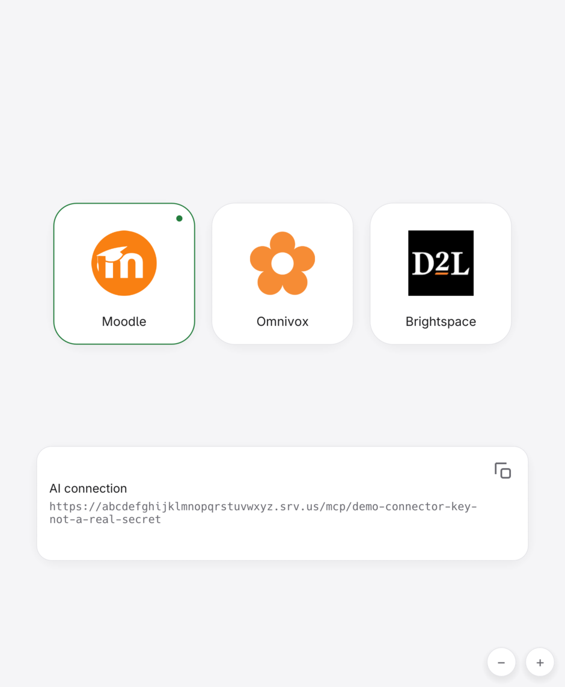
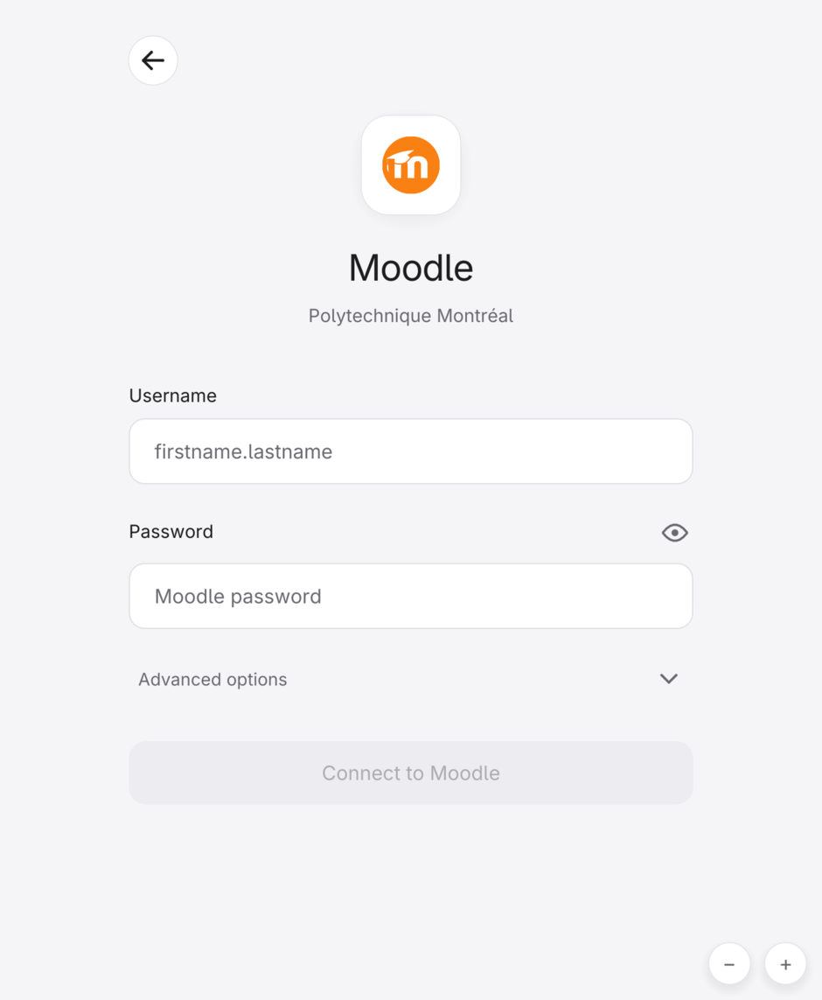

<h1 align="center">student-mcp</h1>
<p align="center">Moodle, Omnivox and Brightspace in your MCP assistant.</p>

<p align="center"></p>

## Install

Download from the [latest release](https://github.com/CloudDown/student-mcp/releases/latest):

- **Windows:** open the `-setup.exe`, install and launch.
- **macOS:** open the `.dmg`, double-click **Install student-mcp**.
- **arm64** for Apple Silicon / Windows ARM; **x64** for Intel / AMD.

Linux:

```sh
curl -fsSL https://raw.githubusercontent.com/CloudDown/student-mcp/main/install.sh | bash
```

Windows/macOS builds are not yet publisher-signed/notarized and may be blocked.
[Installation details](docs/DISTRIBUTION.md).

<p align="center"><br /><sub>Connect your school account</sub></p>

Sign in → copy the link → add it to your assistant's **MCP connectors**.
Keep the app running and your computer online. Keep the link private.

<p align="center"><a href="docs/GUIDE.md">Docs</a> · <a href="docs/SRVUS-EXPERIMENT.md#security-boundary">Privacy &amp; relay</a> · MIT</p>
