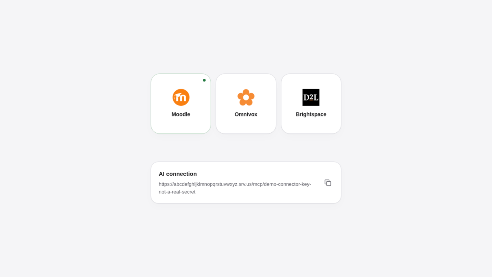
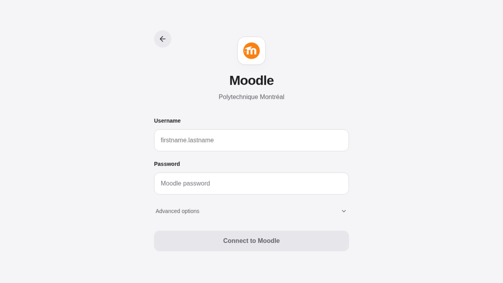

<h1 align="center">student-mcp</h1>
<p align="center">
  
</p>
<p align="center">Moodle, Omnivox and Brightspace in your MCP assistant.</p>

<p align="center"></p>

## Install

### Windows

In PowerShell:

```powershell
irm https://raw.githubusercontent.com/CloudDown/student-mcp/main/tools/packaging/install.ps1 | iex
```

That downloads the native binaries from the [latest release](https://github.com/CloudDown/student-mcp/releases/latest), installs under `%LOCALAPPDATA%\student-mcp`, adds a Start menu shortcut, and opens the configuration page.

### macOS

Download **[student-mcp.dmg](https://github.com/CloudDown/student-mcp/releases/latest/download/student-mcp.dmg)** → open → double-click **Install student-mcp**.

### Linux

```sh
curl -fsSL https://raw.githubusercontent.com/CloudDown/student-mcp/main/tools/packaging/install.sh | bash
```

Or take `student-mcp-linux-x64` / `student-mcp-linux-arm64` from the same release page.

Windows/macOS builds are not yet publisher-signed. [Details](tools/GUIDE.md#installation).

<p align="center"></p>

<table>
  <tr>
    <td width="33%" align="center"><br /><b>Moodle</b><br /><sub>Courses, deadlines, grades &amp; PDFs</sub></td>
    <td width="33%" align="center"><br /><b>Omnivox</b><br /><sub>Léa · Grades, documents &amp; schedule</sub></td>
    <td width="33%" align="center"><br /><b>Brightspace</b><br /><sub>myCourses · Courses, content &amp; grades</sub></td>
  </tr>
</table>

Sign in on the local page → copy the link → add it to your assistant's **MCP connectors**.
Keep the computer online. Closing the tab leaves a tray icon; quit from there or from the page.

**v0.6.1:** Moodle and Brightspace are the stable connectors. Omnivox is still experimental and may fail on real college sites.

<p align="center"><a href="tools/GUIDE.md">Docs</a> · <a href="tools/GUIDE.md#4-automatic-public-link-for-web-ai">Privacy &amp; relay</a> · MIT code; <a href="src/services/moodle/catalog/LICENSE.md">GPL-3.0+ Moodle catalogue</a></p>
