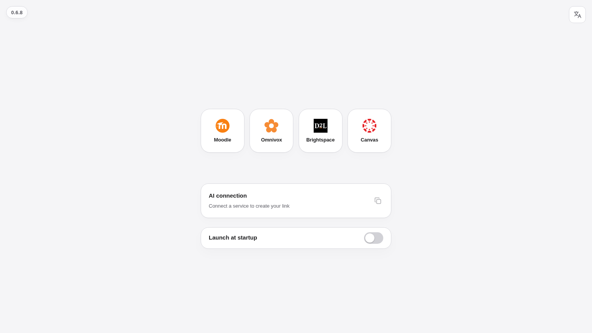
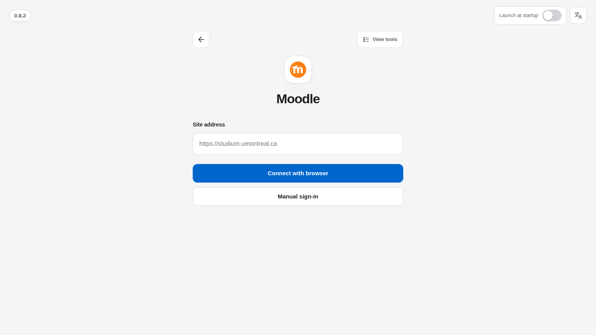
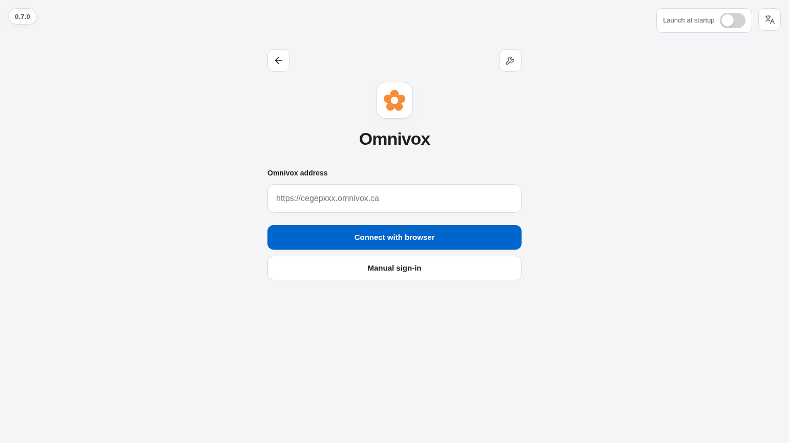
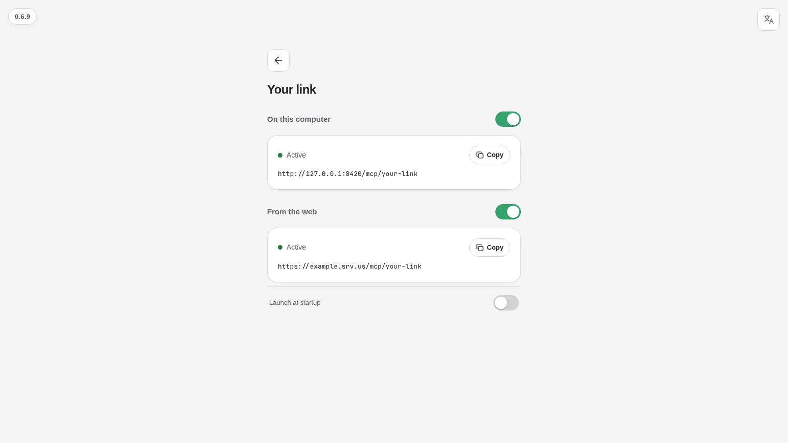

<h1 align="center">student-mcp</h1>
<p align="center">
  
</p>
<p align="center">Ask your AI about your courses, deadlines, grades and files — without typing your school password into the chat.</p>

## Install

### Windows

Download **[student-mcp-setup.exe](https://github.com/CloudDown/student-mcp/releases/latest/download/student-mcp-setup.exe)** and open it. Keep **Open student-mcp** selected.

### macOS

Download **[student-mcp.dmg](https://github.com/CloudDown/student-mcp/releases/latest/download/student-mcp.dmg)**, open it, double-click **Install student-mcp**, then **Install and open**.

### Linux

```sh
curl -fsSL https://raw.githubusercontent.com/CloudDown/student-mcp/main/tools/packaging/install.sh | bash
```

The installer adds student-mcp to the application menu. Windows or macOS may warn that the app is unsigned until publisher signatures are added; do not turn off those checks.

## 1. Open student-mcp

Launch it from the Start menu, Applications, or your app launcher. A local page opens. Closing the tab leaves a tray icon; quit from there when you are done.

<p align="center"></p>

## 2. Connect your school

Click **Moodle**, **Omnivox**, **Brightspace** or **Canvas** — or type your cégep or university in the search field, which opens the right service with the address already filled in. Then **Connect with browser**. Sign in on the school site, including MFA if asked. Only a token or a private browser profile is saved — not your password. Canvas uses that session cookie; it does not ask for a personal access token.

If Chrome, Edge or Brave is already installed, that browser is used. A download is offered only if none is found, and only after you agree.

<p align="center"></p>

When the page says you are connected, go back to the home screen.

<p align="center"></p>

## 3. Copy your AI link

Your link appears under your school. Press the copy button. Keep this computer awake and online. Do not put the link in a screenshot or a chat. Open the card to choose between the local and public link.

<p align="center"></p>

## 4. Add the link to your assistant

Paste the **complete** `https://…/mcp/…` link into the assistant’s MCP connector settings, not into a chat message.

### Claude

1. Open Claude → **Settings** → **Connectors** (wording can vary).
2. Add a custom connector and paste the link.
3. If Claude mentions OAuth, choose **Continue anyway**. This app has no OAuth.
4. Ask: “What are my deadlines this week?”

### ChatGPT

1. Open ChatGPT → **Settings** → **Connectors** / **MCP** (available on plans that allow custom MCP).
2. Add a connector and paste the same link.
3. Start a new chat and ask about a course or a file.

### OpenCode

1. Open OpenCode settings and add an MCP server.
2. For the public link, use the HTTP connector URL you copied.
3. For a local assistant on this computer, you can instead point stdio at the installed binary (`student-mcp` with no arguments). Details: [tools/GUIDE.md](tools/GUIDE.md#3-local-ai-assistant).
4. Ask your first question.

You should be able to go from install to that question in a few minutes on Windows or macOS, with no terminal.

## Privacy

School passwords are not stored. The public link is a secret: anyone who has it can use your enabled tools. The HTTPS relay (`srv.us`) can technically read traffic. Prefer the local link or stdio if you do not want that. [Privacy and relay](tools/GUIDE.md#4-automatic-public-link-for-web-ai).

Technical maintenance, packaging and signing: [tools/GUIDE.md](tools/GUIDE.md).

MIT code; [GPL-3.0+ Moodle catalogue](src/services/moodle/catalog/LICENSE.md).
